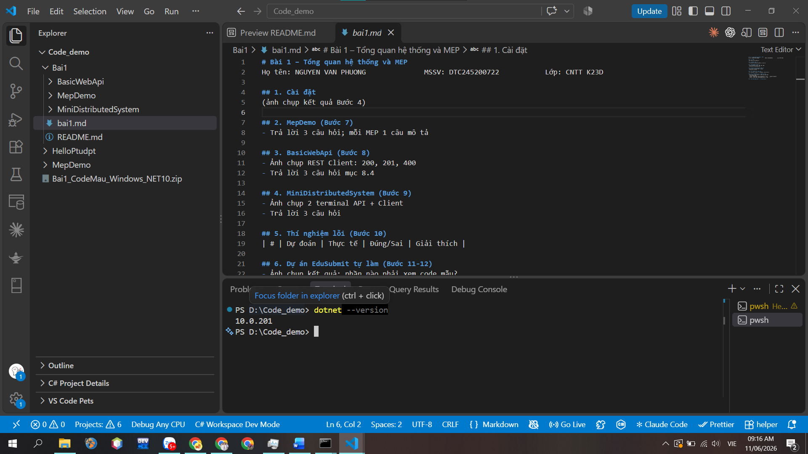
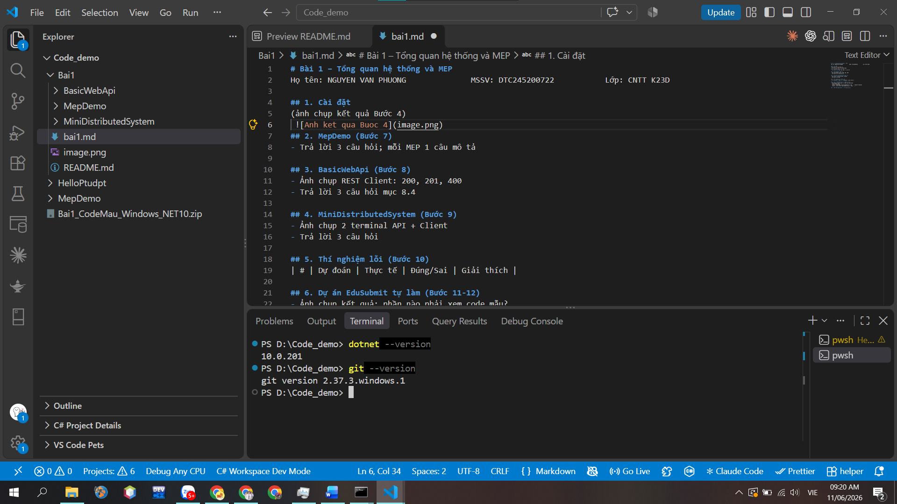
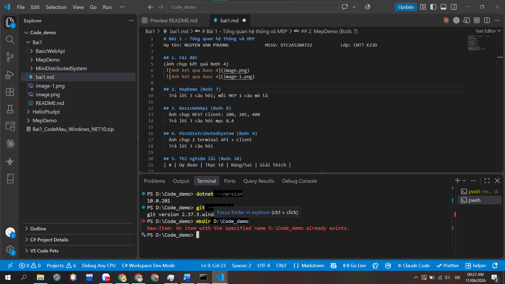
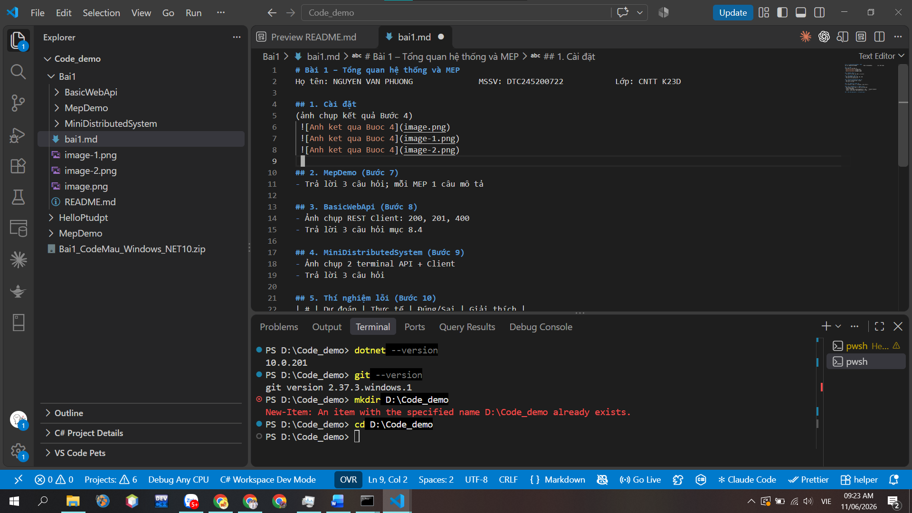
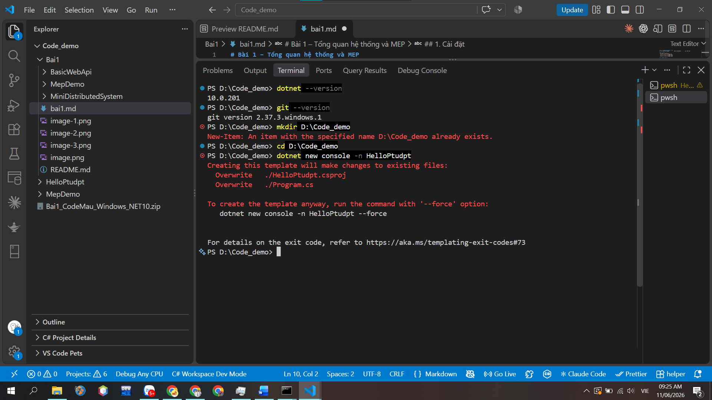
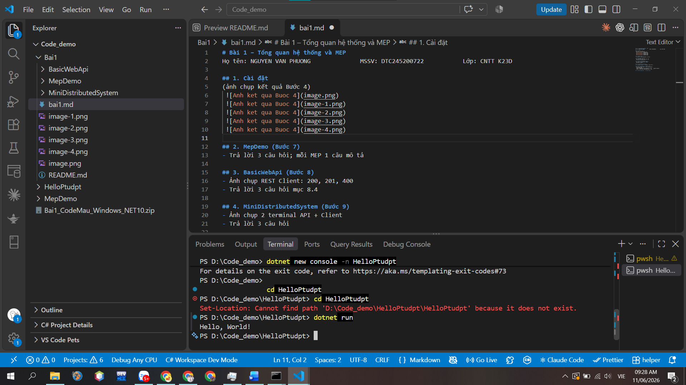

# Bài 1 – Tổng quan hệ thống và MEP
Họ tên:  NGUYEN VAN PHUONG            MSSV:DTC245200722              Lớp:CNTT K23D
 
## 1. Cài đặt
(ảnh chụp kết quả Bước 4)

## 2. MepDemo (Bước 7)
- Trả lời 3 câu hỏi; mỗi MEP 1 câu mô tả
 
## 3. BasicWebApi (Bước 8)
- Ảnh chụp REST Client: 200, 201, 400
- Trả lời 3 câu hỏi mục 8.4
 
## 4. MiniDistributedSystem (Bước 9)
- Ảnh chụp 2 terminal API + Client
- Trả lời 3 câu hỏi
 
## 5. Thí nghiệm lỗi (Bước 10)
| # | Dự đoán | Thực tế | Đúng/Sai | Giải thích |
 
## 6. Dự án EduSubmit tự làm (Bước 11-12)
- Ảnh chụp kết quả; phần nào phải xem code mẫu?
- Luồng thông điệp:
  Client --(HTTP GET /api/assignments)--> Api   : request-response
  Client --(HTTP POST /api/submissions)--> Api  : ...
 
## 7. Khó khăn gặp phải và cách giải quyết

