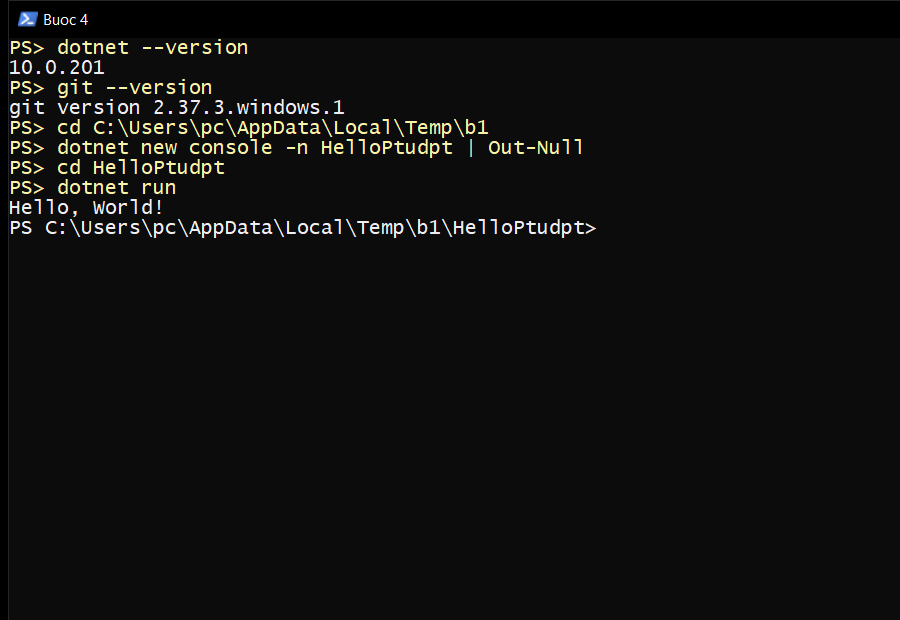
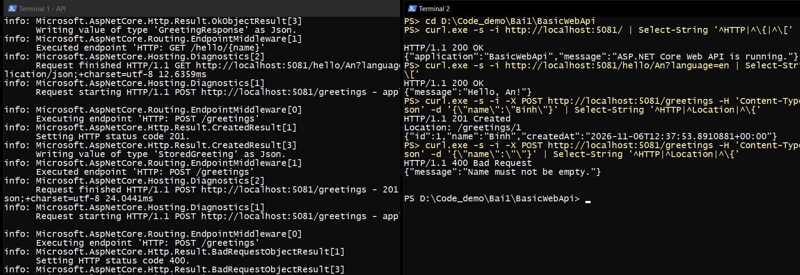
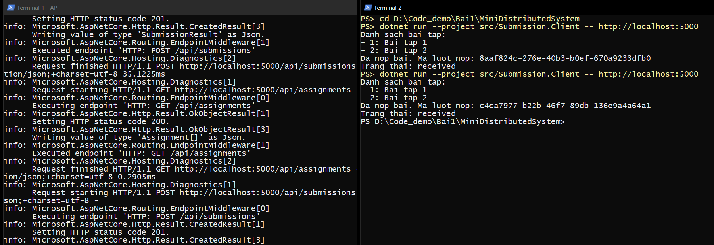
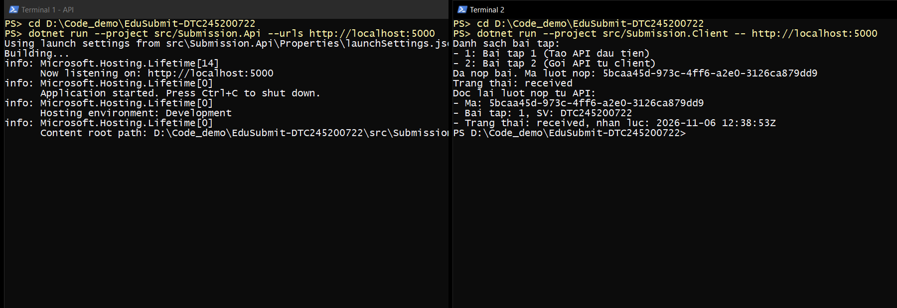
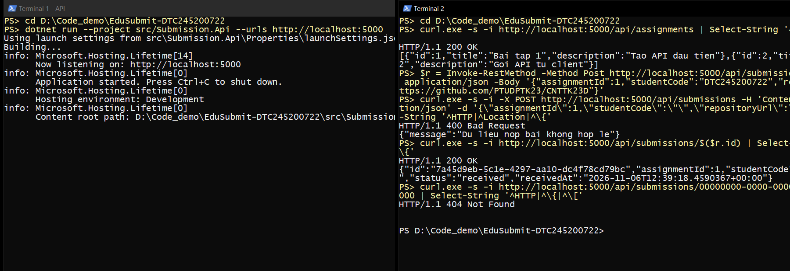

# Bài 1 – Tổng quan hệ thống và MEP

Họ tên: Nguyễn Văn Phương     MSSV: DTC245200722     Lớp: CNTT K23D

## 1. Cài đặt

- .NET SDK: `10.0.201`
- Git: `2.37.3.windows.1`



## 2. MepDemo (Bước 7)

1. Ở MEP 3 (queue-based), mỗi bài nộp `sub-x` chỉ được **một** worker xử lý – các worker cạnh tranh và chia nhau việc trong hàng đợi.
2. Ở MEP 4 (publish–subscribe), một sự kiện được gửi tới **cả 3** dịch vụ đã đăng ký.
3. Mô tả mỗi MEP:
   - **Request–response**: bên gọi gửi yêu cầu rồi chờ phản hồi (có timeout) mới làm tiếp.
   - **One-way**: bên gửi đẩy thông điệp đi và không chờ kết quả.
   - **Queue-based**: thông điệp vào hàng đợi, nhiều worker cạnh tranh, mỗi thông điệp chỉ một worker xử lý.
   - **Publish–subscribe**: một sự kiện được phát tới tất cả các bên đăng ký nhận.
   - **Streaming / push**: máy chủ đẩy liên tục một dòng dữ liệu cho bên nhận khi có dữ liệu mới.

## 3. BasicWebApi (Bước 8)

Kiểm thử 200 / 201 / 400 (Terminal 1: API, Terminal 2: các request):



1. `builder.Services.AddSingleton…` phải đứng **trước** `builder.Build()`: dịch vụ phải được đăng ký trong pha chuẩn bị; sau khi `Build()` thì tập dịch vụ đã cố định, không thêm được nữa.
2. Trong `/hello/{name}?language=en`: `name` lấy từ **route** (đoạn đường dẫn), `language` lấy từ **query string**.
3. POST hợp lệ trả **201 Created** vì nó tạo ra một tài nguyên mới; 201 kèm header `Location` chỉ tới tài nguyên đó, còn 200 chỉ có nghĩa là "thành công" chung chung.

## 4. MiniDistributedSystem (Bước 9)

Hai tiến trình API + Client; chạy client 2 lần cho ra 2 mã lượt nộp khác nhau:



1. Client gọi 2 endpoint:
   - `GET /api/assignments` → **200 OK** kèm mảng bài tập.
   - `POST /api/submissions` → **201 Created** kèm lượt nộp (hoặc 400 nếu dữ liệu sai).
2. Client **không** tham chiếu code của API. Hai bên thống nhất qua **hợp đồng dữ liệu**: URL, method, và "hình dạng" JSON (tên trường, kiểu dữ liệu). Mỗi bên tự khai báo record riêng.
3. Địa chỉ API được truyền qua tham số `-- http://localhost:5000` để client chạy được với bất kỳ môi trường nào (máy khác, cổng khác, server thật) mà không cần sửa và build lại code.

## 5. Thí nghiệm lỗi (Bước 10)

| # | Dự đoán | Thực tế | Đúng/Sai | Giải thích |
|---|---------|---------|----------|------------|
| a | Client tự in thêm bài tập 3, không cần sửa code | Client in `- 3: Bai tap 3`, không sửa gì | Đúng | Client đọc mảng JSON và lặp qua từng phần tử, không phụ thuộc số lượng. Hợp đồng dữ liệu không đổi nên client không cần sửa. |
| b | Client báo lỗi không kết nối được | `HttpRequestException: No connection could be made because the target machine actively refused it. (localhost:5000)` | Đúng | Gọi qua mạng cần một tiến trình khác đang lắng nghe; nếu tiến trình đó tắt, mạng lỗi hoặc sai cổng thì lời gọi thất bại. Gọi hàm trong cùng chương trình thì hàm luôn tồn tại trong cùng bộ nhớ, không qua mạng. |
| c | API trả 400 và client dừng vì lỗi | `HttpRequestException: Response status code does not indicate success: 400 (Bad Request).` | Đúng | `EnsureSuccessStatusCode()` ném ngoại lệ nếu mã không thuộc 2xx, để client không đọc nhầm phản hồi lỗi như dữ liệu đúng. Máy chủ phải tự kiểm tra vì không thể tin client: client có thể lỗi, cũ, hoặc là công cụ khác (curl, Postman) gửi dữ liệu bất kỳ. |
| d | Client lỗi "actively refused" vì gọi sai cổng | Lỗi `actively refused it. (localhost:5000)`; chạy lại bằng `dotnet run --project src/Submission.Client -- http://localhost:5050` thì thành công | Đúng | Sửa bằng cách truyền địa chỉ mới qua tham số dòng lệnh `args[0]`, không cần sửa code. |

## 6. Dự án EduSubmit tự làm (Bước 11-12)

Chạy API:

```bash
dotnet run --project src/Submission.Api --urls http://localhost:5000
```

Chạy client (terminal thứ 2):

```bash
dotnet run --project src/Submission.Client -- http://localhost:5000
```



Kết quả client:

```text
Danh sach bai tap:
- 1: Bai tap 1 (Tao API dau tien)
- 2: Bai tap 2 (Goi API tu client)
Da nop bai. Ma luot nop: 4df34c15-67bb-4dd3-ba33-ae90c6e8f07a
Trang thai: received
Doc lai luot nop tu API:
- Ma: 4df34c15-67bb-4dd3-ba33-ae90c6e8f07a
- Bai tap: 1, SV: DTC245200722
- Trang thai: received, nhan luc: 2026-11-06 12:32:06Z
```

Kiểm thử bằng `requests.http`:

| Request | Mã trả về |
|---------|-----------|
| `GET /` | 200 |
| `GET /api/assignments` | 200 |
| `POST /api/submissions` hợp lệ | 201 + `Location: /api/submissions/{id}` |
| `POST /api/submissions` thiếu `studentCode` | 400 |
| `POST /api/submissions` với `assignmentId = 0` | 400 |
| `GET /api/submissions/{id}` có thật (bài mở rộng) | 200 |
| `GET /api/submissions/{id}` không tồn tại (bài mở rộng) | 404 |



Bài mở rộng (Bước 12):
- API lưu mỗi lượt nộp vào `List<SubmissionResult>`.
- Thêm `GET /api/submissions/{id:guid}`: trả 200 nếu tìm thấy, 404 nếu không có.
- Client đọc lại lượt nộp vừa tạo và in ra.

Phần đã phải xem code mẫu: 
- Đối chiếu với D:\Code_demo\Bai1\MiniDistributedSystem\src khi viết phần kiểm tra dữ liệu (400 Bad Request) và cách trả Results.Created kèm header Location.
- Phía Client: xem lại cách dùng GetFromJsonAsync, PostAsJsonAsync, ReadFromJsonAsync.
- Có dùng trợ lý AI để hỗ trợ viết code và kiểm tra lỗi; sau đó đã đọc lại và chạy thử từng endpoint.

Luồng thông điệp:

```text
Client --(HTTP GET /api/assignments)-------> Api : request-response (200)
Client --(HTTP POST /api/submissions)------> Api : request-response (201 / 400)
Client --(HTTP GET /api/submissions/{id})--> Api : request-response (200 / 404)
```

## 7. Khó khăn gặp phải và cách giải quyết

- Lần đầu chạy client báo lỗi "actively refused it" vì chưa chạy API trước. Cách giải quyết: chạy API ở Terminal 1, chờ dòng "Now listening on: http://localhost:5000" rồi mới chạy client.
- Nộp bài lần đầu chỉ upload file nhật ký và ảnh, thiếu code (src, requests.http, .slnx). Cách giải quyết: commit bổ sung toàn bộ dự án EduSubmit vào thư mục Bai1, PR tự cập nhật.
- Chưa quen với quy trình Fork + Pull Request trên GitHub. Cách giải quyết: đọc lại hướng dẫn nộp bài, làm theo từng bước Fork → Upload → Open pull request.
- Trong PowerShell, lệnh curl không chạy như mong đợi. Cách giải quyết: dùng curl.exe thay cho curl (theo Phụ lục 1).
