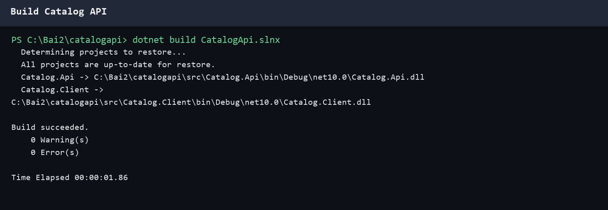
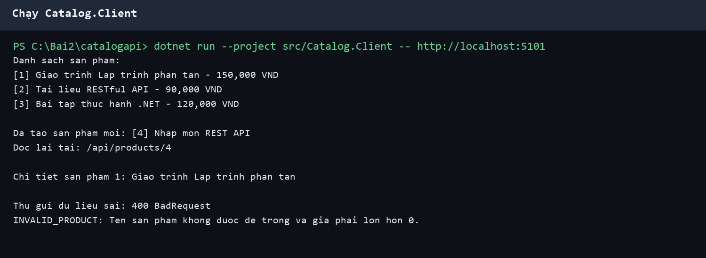
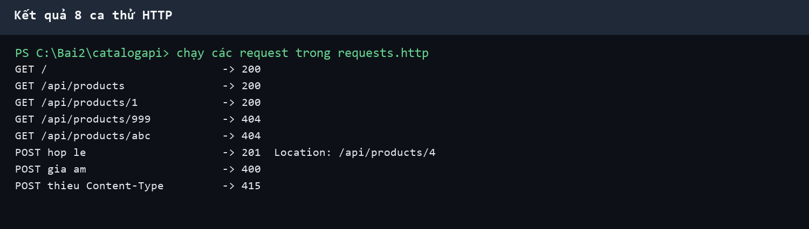

# Bài 2 - Catalog API

## Lệnh đã chạy

Trong thư mục `catalogapi`:

```powershell
dotnet build CatalogApi.slnx
dotnet run --project src/Catalog.Api --no-launch-profile --urls http://localhost:5100
```

Mở terminal khác rồi chạy client:

```powershell
dotnet run --project src/Catalog.Client -- http://localhost:5100
```

## Kết quả chạy

Build thành công, không có lỗi:



Client chạy đủ 4 phần: xem danh sách, thêm sản phẩm, xem chi tiết và thử dữ liệu sai:



Kết quả 8 request:



## Bảng phá thử

| Ca thử | Mong đợi | Thực tế |
| --- | --- | --- |
| `GET /` | 200 | 200 |
| `GET /api/products` | 200, có 3 sản phẩm lúc mới chạy | 200, có 3 sản phẩm |
| `GET /api/products/1` | 200 | 200 |
| `GET /api/products/999` | 404, `PRODUCT_NOT_FOUND` | 404, `PRODUCT_NOT_FOUND` |
| `GET /api/products/abc` | 404, body rỗng | 404, body rỗng |
| POST sản phẩm hợp lệ | 201, có `Location` | 201, `Location: /api/products/4` |
| POST giá âm | 400, `INVALID_PRODUCT` | 400, `INVALID_PRODUCT` |
| POST thiếu `Content-Type` | 415 | 415 |

## Trả lời 3 câu hỏi

### 1. Vì sao URI dùng danh từ, còn hành động do phương thức HTTP đảm nhận?

URI dùng để chỉ tài nguyên, ví dụ `/api/products`. Việc muốn làm gì với tài nguyên được thể hiện bằng phương thức HTTP: GET để đọc, POST để tạo. Cách này giúp địa chỉ dễ hiểu và đúng kiểu REST.

### 2. Stateless thể hiện ở đâu trong code đã viết?

Mỗi request có đủ thông tin để server xử lý, server không lưu phiên đăng nhập hay trạng thái riêng của client. Danh sách `products` là dữ liệu của tài nguyên trên server, không phải session của client.

### 3. Vì sao client và server mỗi bên khai báo DTO riêng mà vẫn khớp nhau?

Hai bên trao đổi bằng JSON. Chỉ cần tên thuộc tính và kiểu dữ liệu khớp với hợp đồng JSON thì bộ chuyển đổi sẽ đọc được, dù hai record DTO nằm ở hai project khác nhau.

## Thử nghiệm bước 9

- Chạy client lần hai: thấy 4 sản phẩm và thêm sản phẩm số 5.
- Tắt API rồi chạy client: kết nối bị từ chối.
- Mở lại API: danh sách còn 3 sản phẩm mẫu vì dữ liệu chỉ lưu trong bộ nhớ.
- Chạy client sai cổng 5999: kết nối bị từ chối.
