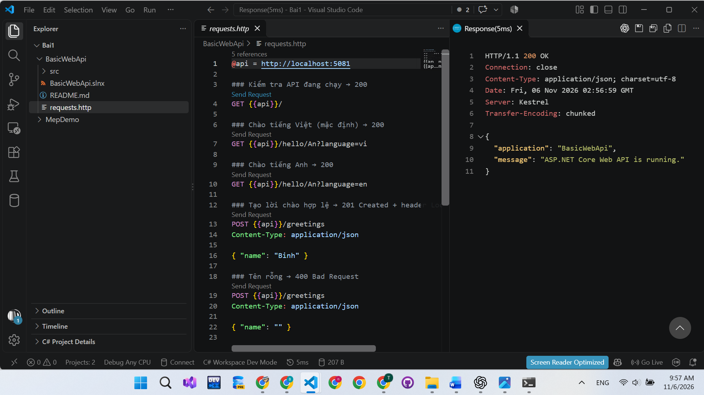
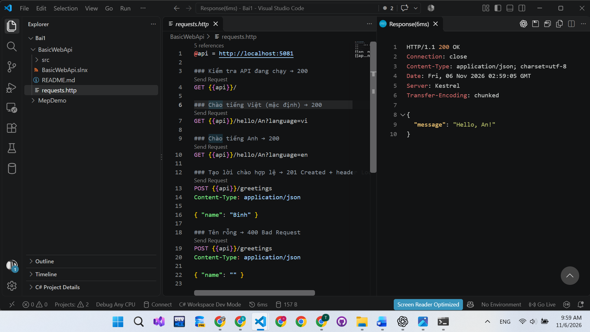
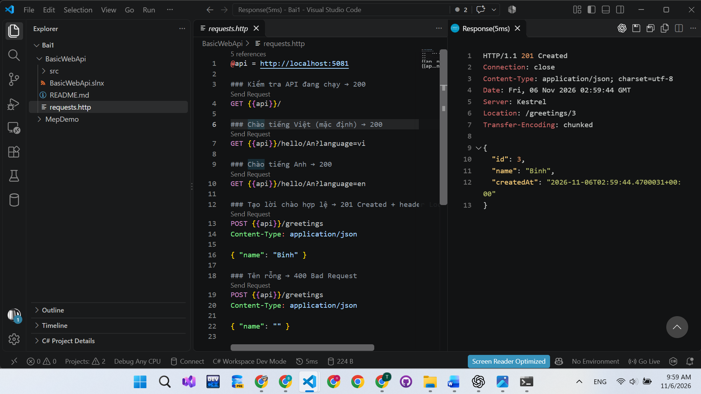
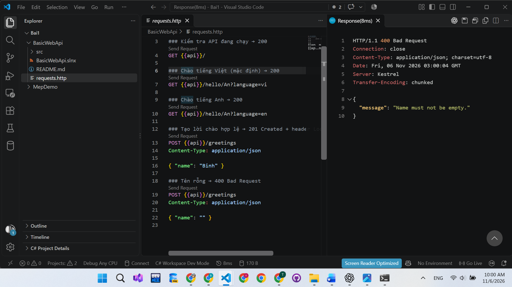

# Bài 1 – Tổng quan hệ thống và MEP
Họ tên:Tạ Hoàng Anh             MSSV:DTC245200117              Lớp:CNTTK23D
 
## 1. Cài đặt
(ảnh chụp kết quả Bước 4)

 
## 2. MepDemo (Bước 7)

- Trả lời 3 câu hỏi; mỗi MEP 1 câu mô tả
Trả lời ba câu hỏi: 
MEP 3: Mỗi bài nộp sub-x được một worker xử lý. Các worker chia nhau chấm các bài nộp trong hàng đợi.
MEP 4: Một sự kiện được gửi tới cả 3 dịch vụ đã đăng ký: ScoreService, NotificationService và StatsService.
Mô tả 5 mô hình MEP
•	Request–response — Bên gửi gửi yêu cầu và chờ bên nhận trả lời.
•	One-way — Bên gửi gửi thông điệp rồi tiếp tục công việc mà không chờ phản hồi.
•	Queue-based — Công việc được đưa vào hàng đợi để các worker chia nhau xử lý.
•	Publish–subscribe — Khi một sự kiện được phát, tất cả dịch vụ đã đăng ký loại sự kiện đó đều nhận được.
•	Streaming — Dữ liệu được truyền thành nhiều phần liên tiếp, bên nhận có thể xử lý từng phần ngay khi nhận được.

 
## 3. BasicWebApi (Bước 8)
- Ảnh chụp REST Client: 200, 201, 400
+200:

+201:

+400:

- Trả lời 3 câu hỏi mục 8.4
builder.Services.AddSingleton(...) phải đứng trước var app = builder.Build(); vì dịch vụ cần được đăng ký trước khi ứng dụng xây dựng bộ quản lý dịch vụ.

name lấy từ đường dẫn. Ví dụ, trong /hello/An?language=en, name có giá trị An. language lấy từ chuỗi truy vấn sau dấu ?, nên có giá trị en.

POST hợp lệ trả Results.Created với mã 201 vì yêu cầu đã tạo thành công một lời chào mới. Phản hồi còn có header Location chứa địa chỉ của lời chào vừa tạo.
 
## 4. MiniDistributedSystem (Bước 9)
- Ảnh chụp 2 terminal API + Client
- Trả lời 3 câu hỏi
 Z
 
## 5. Thí nghiệm lỗi (Bước 10)
| # | Dự đoán | Thực tế | Đúng/Sai | Giải thích |
 
## 6. Dự án EduSubmit tự làm (Bước 11-12)
- Ảnh chụp kết quả; phần nào phải xem code mẫu?
- Luồng thông điệp:
  Client --(HTTP GET /api/assignments)--> Api   : request-response
  Client --(HTTP POST /api/submissions)--> Api  : ...
 
## 7. Khó khăn gặp phải và cách giải quyết
